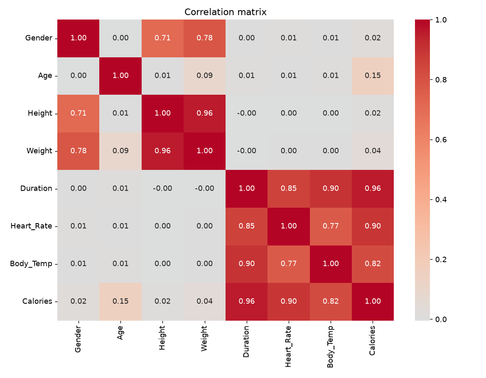
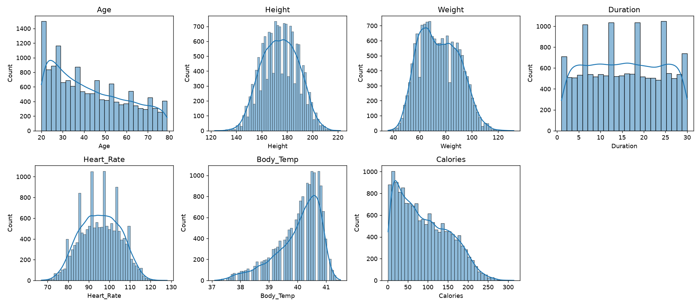
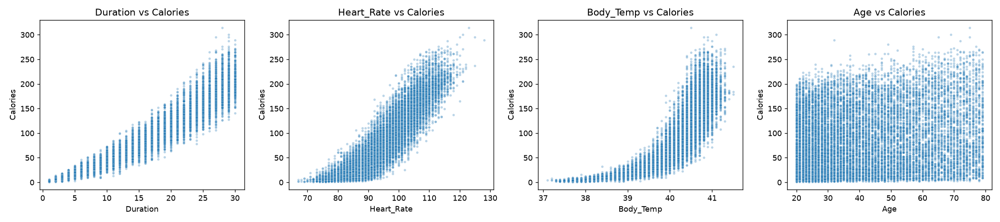
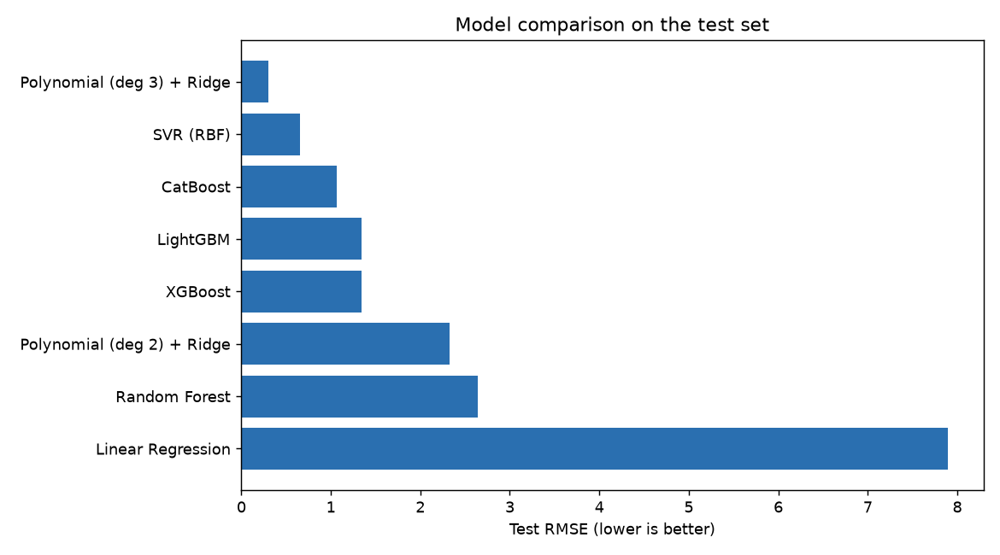
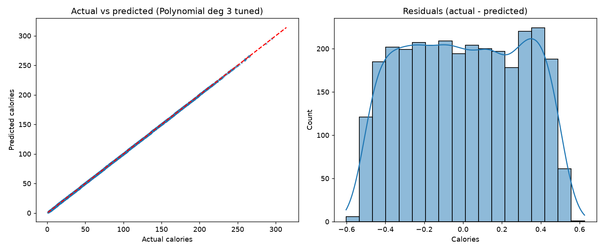

# Calories Burned Prediction


A machine learning project that predicts the number of calories burned during
exercise from personal and physiological measurements. Eight regression models
are trained, cross-validated, tuned and compared on a dataset of 15,000
exercise sessions.

**Best model:** Polynomial Regression (degree 3) with Ridge regularization,
reaching a test **RMSE of 0.294 calories** and **R² = 1.0000**.

---

## Dataset

Two CSV files in `data/`, merged on `User_ID` (15,000 records, no missing
values, no duplicates):

| Feature | Description |
|---|---|
| `Gender` | male / female (encoded as 1 / 0) |
| `Age` | years (20-79) |
| `Height` | cm |
| `Weight` | kg |
| `Duration` | exercise duration in minutes (1-30) |
| `Heart_Rate` | beats per minute during exercise |
| `Body_Temp` | body temperature in °C during exercise |
| **`Calories`** | **target:** calories burned (1-314) |

---

## Methodology

1. **Data preparation:** merge on `User_ID`, drop the identifier, encode `Gender`,
   check missing values, duplicates and outliers (IQR rule; outliers are
   physiologically plausible and kept).
2. **Exploratory analysis:** distributions, correlation matrix and
   feature-vs-target plots.
3. **Feature engineering:** `BMI`, `Heart_Rate x Duration`, `Body_Temp x Duration`.
4. **Split:** 80% train (12,000) / 20% test (3,000), `random_state=42`.
   The test set is used only for final evaluation.
5. **Modelling:** 8 models trained inside scikit-learn pipelines. Models sensitive
   to feature scale (linear, polynomial, SVR) use `StandardScaler`.
6. **Validation:** 5-fold cross-validation on the training set.
7. **Tuning:** hyperparameter search for the three strongest model families.
8. **Evaluation:** R², MAE and RMSE on the held-out test set, plus residual analysis.

---

## Exploratory Data Analysis

Correlation with `Calories`:

| Feature | Correlation |
|---|---|
| Duration | 0.96 |
| Heart_Rate | 0.90 |
| Body_Temp | 0.82 |
| Age | 0.15 |
| Weight / Height / Gender | 0.04 / 0.02 / 0.02 |

Observations:
- `Duration`, `Heart_Rate` and `Body_Temp` are the strongest drivers.
- Several features are strongly inter-correlated (Height-Weight 0.96,
  Duration-Body_Temp 0.90), which matters for interpreting linear coefficients.
- The relationship with `Calories` is clearly **non-linear**, especially for
  `Body_Temp` and `Heart_Rate`. Weak marginal correlation of `Weight`, `Age` and
  `Gender` does not make them useless: they modulate the effect of the other features.
- `Calories` is right-skewed; `Body_Temp` is left-skewed.





---

## Models

| Family | Models |
|---|---|
| Linear | Linear Regression (baseline) |
| Polynomial | Polynomial degree 2 and 3 + Ridge |
| Kernel | Support Vector Regression (RBF) |
| Bagging | Random Forest |
| Gradient boosting | XGBoost, LightGBM, CatBoost |

---

## Results

### Test set (sorted by RMSE)

| Rank | Model | R² | MAE | RMSE |
|---|---|---|---|---|
| 1 | **Polynomial (deg 3) + Ridge [tuned]** | 1.0000 | 0.255 | **0.294** |
| 2 | Polynomial (deg 3) + Ridge | 1.0000 | 0.259 | 0.302 |
| 3 | SVR (RBF) [tuned] | 1.0000 | 0.261 | 0.308 |
| 4 | SVR (RBF) | 0.9999 | 0.436 | 0.657 |
| 5 | CatBoost [tuned] | 0.9998 | 0.524 | 0.785 |
| 6 | CatBoost | 0.9997 | 0.778 | 1.062 |
| 7 | LightGBM | 0.9996 | 0.896 | 1.343 |
| 8 | XGBoost | 0.9996 | 0.957 | 1.343 |
| 9 | Polynomial (deg 2) + Ridge | 0.9987 | 1.717 | 2.329 |
| 10 | Random Forest | 0.9983 | 1.689 | 2.645 |
| 11 | Linear Regression | 0.9845 | 5.819 | 7.897 |

### 5-fold cross-validation (training set, default settings)

| Model | CV RMSE | Std |
|---|---|---|
| Polynomial (deg 3) + Ridge | 0.304 | 0.004 |
| SVR (RBF) | 0.776 | 0.077 |
| CatBoost | 1.178 | 0.079 |
| XGBoost | 1.430 | 0.072 |
| LightGBM | 1.468 | 0.136 |
| Polynomial (deg 2) + Ridge | 2.312 | 0.031 |
| Random Forest | 2.924 | 0.075 |
| Linear Regression | 7.759 | 0.061 |

The ranking is stable across folds and consistent with the test results.

### Best hyperparameters found

| Model | Parameters |
|---|---|
| Polynomial (deg 3) + Ridge | `alpha=1` |
| SVR (RBF) | `C=1000, epsilon=0.5, gamma=0.02` |
| CatBoost | `depth=8, learning_rate=0.05, iterations=1000, l2_leaf_reg=3` |




---

## Key Findings

- **Non-linear models are essential.** Polynomial regression cuts the error of the
  linear baseline by roughly 27x (RMSE 7.90 to 0.29).
- **Smooth models win on smooth data.** Polynomial regression and SVR outperform
  tree ensembles, which approximate smooth functions with piecewise-constant steps.
- **Tuning helps unevenly.** SVR improved from RMSE 0.66 to 0.31 and CatBoost from
  1.06 to 0.78, while Polynomial regression was already near its optimum.
- **No overfitting** for the top models: train and test R² are equal.
- **The best models reach the noise floor.** `Calories` is stored as whole numbers;
  rounding alone produces errors that are uniform in ±0.5, i.e. an RMSE of about
  0.289. The best model (0.294) is essentially at that limit, so further tuning
  would not give meaningful gains. The residual plot (flat, bounded within ±0.6)
  is consistent with this.

---

## Limitations

- The data appears to be **synthetic** (a smooth, almost deterministic relationship).
  Results on real wearable-sensor data would be noisier and the ranking of models
  may differ.
- Results use a single train/test split (plus cross-validation on the training set).
- The contribution of the engineered features was not isolated in an ablation study.
- Hyperparameter search covered small grids.

---

## Project Structure

```
calories-prediction/
├── data/
│   ├── calories.csv
│   └── exercise.csv
├── notebooks/
│   ├── 01_eda_and_cleaning.ipynb
│   └── 02_models_comparison.ipynb
├── figures/                 # plots used in this README
├── requirements.txt
├── .gitignore
└── README.md
```

---

## Getting Started

```bash
git clone https://github.com/Ahmed55455/calories-prediction.git
cd calories-prediction

python -m venv .venv
# Windows (PowerShell)
.venv\Scripts\Activate.ps1
# macOS / Linux
source .venv/bin/activate

pip install -r requirements.txt
```

Open the project in VS Code (or Jupyter), select the `.venv` kernel and run:

1. `notebooks/01_eda_and_cleaning.ipynb`
2. `notebooks/02_models_comparison.ipynb`

> Note: the hyperparameter search cells take roughly 15-20 minutes (mostly SVR).
> The best parameters are listed above if you want to skip the search.

---

## Future Work

- Validate on real wearable-sensor data.
- Ablation study of the engineered features.
- Repeated cross-validation and statistical tests between the top models.
- Wrap the best model in a small prediction app or API.

---

## Author

Built by [Ahmed55455](https://github.com/Ahmed55455) as a machine learning
regression project.